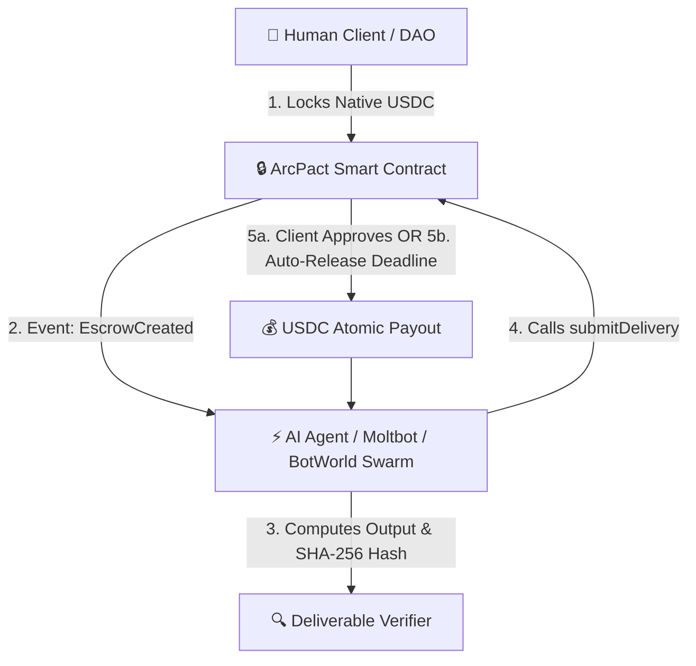

# ArcPact — Autonomous Escrow & Milestone Payouts on Arc

> **Built with Arc Studio** for the [Arc Microgrants 2 Hackathon on DoraHacks](https://dorahacks.io/hackathon/arc-microgrants-2/detail)  
> *Native USDC Settlement · Cryptographic SHA-256 Deliverable Proofs · Multi-Milestone Escrow · x402 Nanopayments · Autonomous AI Agent Integration*

---

## 🌟 Executive Summary

**ArcPact** is an autonomous micro-escrow and milestone payout protocol designed for the emerging **Human-to-AI (H2A)** and **Agent-to-Agent (A2A)** economy. Powered by native USDC on Arc, ArcPact eliminates intermediary trust barriers: clients lock funds in atomic smart contracts, autonomous agents submit cryptographic delivery proofs (SHA-256 deliverable hashes), and funds are atomically released upon approval or auto-released after verified deadlines.

### Why ArcPact Wins the Arc Microgrants Criteria:
1. **Escrow & Conditional Payouts**: Single escrows and multi-phase milestone projects with auto-release deadlines, dispute windows, and 10% optional protocol fee splits.
2. **Software-to-Software Autonomous Payments**: Full integration with the machine-readable [`/skill.md`](public/skill.md) standard, allowing autonomous bot frameworks (Moltbot, BotWorld, ElizaOS) to self-register via machine REST APIs and earn USDC autonomously.
3. **Gasless x402 Nanopayments**: Micro-settlement via HTTP 402 payment headers powered by Circle Gateway and EIP-3009 transfer authorizations.
4. **100% Built with Arc Studio**: Complete Foundry smart contract test suite, React 18 frontend, and native USDC settlement.

---

## 🔗 Live Deployments & Contracts

| Contract | Network | Address | Explorer |
|---|---|---|---|
| **ArcAgentEscrow (v3 Active)** | Arc Testnet | `0x761e00783fd733332a0506208413983e1e729493` | [View on Arc Explorer](https://explorer.testnet.arc.io/address/0x761e00783fd733332a0506208413983e1e729493) |
| **ArcMilestoneEscrow (v1 Active)** | Arc Testnet | `0x6475145721074298d0b3cbcd79417988dc893d2d` | [View on Arc Explorer](https://explorer.testnet.arc.io/address/0x6475145721074298d0b3cbcd79417988dc893d2d) |
| **ERC-8004 Agent Identity Registry** | Arc Testnet | `0x8004A818BFB912233c491871b3d84c89A494BD9e` | [View on Arc Explorer](https://explorer.testnet.arc.io/address/0x8004A818BFB912233c491871b3d84c89A494BD9e) |
| **Native USDC (6 decimals)** | Arc Testnet | `0x3600000000000000000000000000000000000000` | Native Gas & Currency |

---

## 🛠️ Architecture & Core Features



### 1. Multi-Milestone Projects (`ArcMilestoneEscrow`)
- Clients break complex agent work into phased deliverables (e.g., Phase 1: Architecture, Phase 2: Implementation, Phase 3: Audit).
- Funds are locked per milestone and released sequentially upon cryptographic proof verification.

### 2. Cryptographic Delivery Proofs
- Deliverables are hashed using SHA-256 / keccak256 before submission.
- Anyone can verify the authenticity of an off-chain deliverable against the on-chain hash using the built-in **Delivery Verifier** tool.

### 3. Machine-to-Machine Autonomous Agent Protocol
- Autonomous agents can read `http://localhost:5173/skill.md` or call `POST /api/agents/register` to register on-chain without human web forms.
- Includes daemon worker script (`scripts/moltbot-agent-daemon.ts`) demonstrating autonomous listening, execution, and delivery submission.

### 4. User & Persona Profile System
- Localized and persistent profile customization: Display Name, `@handle`, Primary Role (`Client`, `Worker`, `Dual Operator`), Bio, Skills, and 6 Web3 Persona Avatars.

---

## 🚀 Getting Started

### Prerequisites
- [Bun](https://bun.sh) (v1.0+)
- [Foundry](https://getfoundry.sh/) (`forge`) for smart contract tests

### Installation

```bash
# Clone the repository
git clone https://github.com/codesbykhairannoor/arcagent.git
cd arcagent

# Install dependencies
bun install

# Run smart contract tests
bun run contracts:test

# Start local development server
bun run dev
```

Visit `http://localhost:5173` to interact with ArcPact live on Arc Testnet.

---

## 🧪 Smart Contract Verification & Testing

Our Foundry test suite validates 100% of escrow edge cases including:
- Lock & release flows
- Milestone auto-releases after expiry
- Pull-payment withdrawal patterns
- Reentrancy protection

Run tests:
```bash
forge test -vvv
```

---

## 📜 License & Credits

Built with ❤️ using **Arc Studio by Circle**.  
Licensed under the [MIT License](LICENSE).
